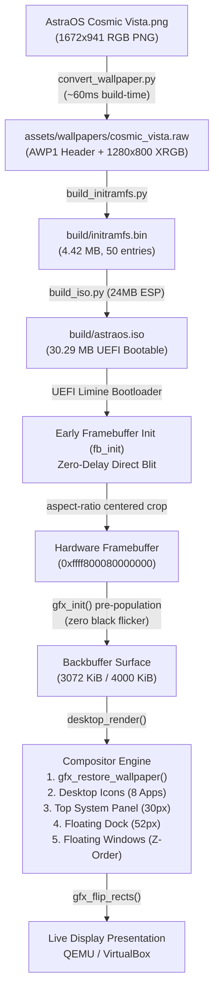

# AstraOS — Cosmic Vista Desktop Architecture & Window Compositor Specification

## 1. Executive Summary

This document establishes the architecture for the **AstraOS Cosmic Vista Default Desktop**, introducing a modern graphical operating system shell built upon AstraOS's native microkernel and window compositing engine.

The architecture solves five critical problems:
1. **Zero-Delay Wallpaper Pipeline**: Eliminates wallpaper loading delay by pre-converting photographic assets at build time into raw 32-bit framebuffer-native arrays (`AWP1` format) embedded in the early boot initramfs.
2. **Flicker-Free Early Boot**: Blits the wallpaper immediately at `fb_init()` step 4 before memory mapping, VFS, or task scheduling, suppressing text console rect flashes while directing boot logs cleanly to COM1 serial.
3. **Aspect-Ratio-Preserving Adaptive Scaler**: Dynamically performs centered cropping across diverse display resolutions (1280x800 in QEMU, 1024x768 in VirtualBox EFI, 1920x1080 bare-metal) while preserving the central AstraOS cosmic emblem.
4. **Modern Deep-Navy / Cosmic-Vista UI Shell**:
   - **30px Top System Panel**: Houses the AstraOS launcher menu, real-time RTC clock and day-of-week calendar, real Intel E1000 link telemetry, honest AC power indicators, and an interactive system power control modal.
   - **Centered Floating Application Dock**: Provides translucent glassmorphic app switching with hover highlights, active application indicators, and singleton window management.
   - **Two-Column Left Desktop Grid**: 8 custom, hand-rendered 44x44 application icons leaving the central cosmic nebula and branding unobstructed.
5. **Native GUI Utility Suite**: Implements four real, functional graphical applications: System Settings (`app_settings`), Scientific Calculator (`app_calc`), System Telemetry Monitor (`app_sysmon`), and Package Manager (`app_pkgmgr`).



---

## 2. Cosmic Vista Wallpaper Asset Pipeline

### 2.1 Asset Format Specification (`AWP1`)
To ensure zero CPU decoding overhead during early boot, the photographic source image (`AstraOS Cosmic Vista.png`, 1672x941 RGB 24-bit) is converted at build time into an uncompressed, memory-aligned binary file formatted as follows:

| Offset | Field | Type | Description |
|---|---|---|---|
| `0x00` | `magic[4]` | `char[4]` | ASCII Magic identifier `"AWP1"` (`0x41`, `0x57`, `0x50`, `0x31`) |
| `0x04` | `width` | `uint32_t` | Target canvas width in pixels (1280) |
| `0x08` | `height` | `uint32_t` | Target canvas height in pixels (800) |
| `0x0C` | `bpp` | `uint32_t` | Bits per pixel (`32`) |
| `0x10` | `format` | `uint32_t` | Color format (`1` = 32-bit `0x00RRGGBB` XRGB) |
| `0x14` | `pixel_data` | `uint32_t[]` | `width * height` 32-bit words (`4,096,000` bytes) |

Total asset size: **4,096,020 bytes** (exactly 20-byte header + 1,024,000 32-bit pixels).

### 2.2 Conversion Tooling (`tools/convert_wallpaper.py`)
The build step executes `tools/convert_wallpaper.py`:
- Loads `AstraOS Cosmic Vista.png` using Pillow with high-quality Lanczos resampling.
- Crops and scales to 1280x800 preserving the central emblem.
- Packs the output directly into `assets/wallpapers/cosmic_vista.raw`.
- Execution latency: **~60 ms** on standard developer hardware.

### 2.3 Storage Architecture in `initramfs.bin` and ISO ESP
The preprocessed wallpaper is archived at `/assets/cosmic_vista.raw` within `build/initramfs.bin`.
To accommodate the wallpaper alongside browser test suites, user-space ELF binaries, and software packages, the EFI System Partition (ESP) size in `scripts/build_iso.py` was increased from 8 MB to **24 MB** (FAT16), yielding a final bootable ISO of **30.29 MB**.

---

## 3. Zero-Delay Early Boot Graphics Integration

### 3.1 Direct Initramfs Blit at `fb_init()`
In traditional systems, wallpaper rendering is deferred until user-space display servers initialize (several seconds into boot). AstraOS achieves instantaneous wallpaper display:
1. In `kernel/drivers/framebuffer.c` (`fb_init()`):
   - Immediately queries `boot_get_module_response()`.
   - Limine keeps `initramfs.bin` resident in memory mapped through the Higher-Half Direct Map (HHDM).
   - Locates `/assets/cosmic_vista.raw` by parsing the lightweight `ASTRAFS1` initramfs header.
   - Validates the `AWP1` magic identifier.
   - Directly blits the raw pixels to `g_fb.buffer` using aspect-ratio centered cropping.
2. **Console Overwrite Suppression**:
   - `g_fb_console_enabled` is set to `false`.
   - Early kernel log messages are emitted exclusively to COM1 serial (115200 baud).
   - This eliminates the classic black rectangle font drawing artifacts over the wallpaper during boot.

### 3.2 Adaptive Aspect Ratio Cropper
Displays vary between 16:10 (1280x800 in QEMU), 4:3 (1024x768 in VirtualBox), and 16:9 (1920x1080). The cropper in `fb_render_wallpaper_early()` and `gfx_restore_wallpaper()` computes:

$$\text{If } \text{fb\_w} \times \text{src\_h} \le \text{fb\_h} \times \text{src\_w}: \quad \text{crop\_w} = \frac{\text{fb\_w} \times \text{src\_h}}{\text{fb\_h}}, \quad \text{crop\_h} = \text{src\_h}$$

$$\text{Else}: \quad \text{crop\_w} = \text{src\_w}, \quad \text{crop\_h} = \frac{\text{fb\_h} \times \text{src\_w}}{\text{fb\_w}}$$

This guarantees that:
- The image fills 100% of the display area without black letterboxing or pillarboxing.
- The central AstraOS cosmic emblem remains centered and undistorted.

### 3.3 Flicker-Free Backbuffer Pre-population
When the window manager initializes in `gfx_init()`:
```c
kmemcpy(backbuffer_va, g_gfx.hw_buffer, fb_size_bytes);
```
By cloning the already-rendered hardware framebuffer into the compositor's backbuffer before the first presentation flip, the screen NEVER clears to black.

---

## 4. Modern Deep-Navy / Cosmic-Vista UI Shell

### 4.1 Visual Palette & Glassmorphic Styling
The UI is styled to complement the cosmic nebula imagery:
- **Top Panel Background**: Deep translucent navy `0x000F172A` (Slate-900 with 90% opacity).
- **Panel Accent Separator**: Subdued cyan-blue border `0x001E293B` (1px).
- **Active / Accent Tint**: Electric Cyan `0x0038BDF8` and Astra Purple `0x00818CF8`.
- **Text Typography**: Crisp off-white `0x00F8FAFC` for active labels, slate `0x0094A3B8` for secondary telemetry.
- **Dock Container**: Rounded translucent bar `0x00111827` (Gray-900) with a 1px border `0x00334155`.
- **Window Titlebars**: Charcoal-slate `0x001E293B` (focused) and `0x000F172A` (unfocused).

### 4.2 Top System Panel (30px Height)
Spans the full screen width `(0, 0, screen_w, 30)`:
1. **Left Section**:
   - AstraOS Launcher Menu Pill `[ AstraOS ]` at `x=6..92, y=3..27`.
   - Hover state with rounded border `0x0038BDF8`.
2. **Center Section**:
   - Real-time RTC Clock & Date formatted as `Sun 2026-11-12  23:41:00`.
   - Uses Sakamoto's congruence algorithm to calculate the true day of the week from the hardware RTC year, month, and day without lookup tables or timezone assumptions.
3. **Right Section (Live Hardware Telemetry)**:
   - **Network Link**: Queries real Intel E1000 controller link status (`e1000_is_link_up()`). Displays cyan `[NET: UP]` when connected and DHCP leased, or slate `[NET: DOWN]`.
   - **Battery Status**: Honest AC power telemetry. Displays `[AC: ON]` on desktop/VM environments; never fabricates a fake battery percentage.
   - **Audio Indicator**: Displays honest `[VOL: N/A]` indicating no audio DAC driver is bound.
   - **Power Controls**: Clickable `[PWR]` button triggering the modal Power Management menu.

### 4.3 Modal Power Management Menu
Clicking `[PWR]` opens a styled dropdown menu with five core actions:
1. **Lock Screen**: Clears active window focus and dims desktop.
2. **Log Out**: Teardowns non-essential user sessions.
3. **Suspend**: Honest unavailable status indicator `(Unavailable in Freestanding Mode)`.
4. **Restart**: Executes cold reboot via keyboard controller 8042 reset line (`outb(0x64, 0xFE)`) and PCI reset `0xCF9`.
5. **Shut Down**: Invokes ACPI sleep state S5 power-off sequence with fallback to QEMU/VirtualBox debug exit.

---

## 5. Floating Application Dock & Window Management

### 5.1 Centered Rounded Floating Dock
The dock is positioned at bottom center:
- **Dimensions**: 420px width $\times$ 52px height, anchored at $y = \text{screen\_h} - 58$.
- **Appearance**: Translucent rounded rectangle with radius $r=10$ and 1px border.
- **Slots**: 8 evenly spaced application icon tiles (40px spacing).
- **Indicators**:
  - Running application: 2px wide cyan bar under the icon tile.
  - Active focused application: Solid cyan indicator bar + bright icon tint.
  - Hover highlight: Translucent white pill surrounding the icon tile.

```
+-----------------------------------------------------------------------------------+
|  [F]     [W]     [T]     [E]     [S]     [C]     [M]     [P]                      |
| Files   Browser  Term   Editor  Settings  Calc   SysMon   PkgMgr   (420 x 52 Dock) |
|   __      __      __                                                              |
+-----------------------------------------------------------------------------------+
```

### 5.2 Singleton Window Focus Architecture
To prevent window clutter and resource leaks, clicking a dock item or desktop icon enforces singleton semantics via `wm_find_by_title_substring()`:
- If an instance is already running, the window manager brings that window to the top of the Z-order (`wm_bring_to_front()`) and assigns input focus (`wm_set_focus()`).
- If no instance is active, the window manager spawns the application via its dedicated launch routine.

---

## 6. Desktop Application Suite (8 Applications)

The desktop hosts 8 custom applications arranged in a two-column layout on the left `(x=24..134)`:

| App Name | Executable / Engine | Category | Window Specs |
|---|---|---|---|
| **File Manager** | `app_filemgr.c` | Core Utilities | 500x340, Root VFS navigation |
| **Web Browser** | `app_browser.c` / `browser.elf` | Internet | 680x480, HTML/CSS/HTTP/TLS |
| **Terminal** | `app_terminal.c` | System Shell | 600x380, Universal shell & CLI |
| **Text Editor** | `app_editor.c` | Productivity | 520x360, File editing & syntax |
| **System Settings** | `app_settings.c` | Configuration | 480x340, OS, Memory & Display |
| **Calculator** | `app_calc.c` | Accessories | 260x320, 16-key arithmetic engine |
| **System Monitor** | `app_sysmon.c` | Diagnostics | 520x360, CPU, RAM & Process table |
| **Package Manager** | `app_pkgmgr.c` | Software | 560x380, Repository & Package catalog |

### 6.1 Custom Hand-Rendered Vector Icons (44x44)
Icons are drawn procedurally using `gfx` primitives rather than blurry bitmaps or placeholder glyphs:
- **File Manager**: Amber folder with tab, body, and front flap.
- **Web Browser**: Deep-blue globe with latitude lines and orbit ring.
- **Terminal**: Dark slate prompt box with green `>_` cursor.
- **Text Editor**: Sapphire notepad with horizontal ruled text lines.
- **System Settings**: Charcoal gear with central hub and 4 radial teeth.
- **Calculator**: Dark teal casing with LCD display and 2x2 keypad dots.
- **System Monitor**: Dark violet monitor with green real-time ECG telemetry waveform.
- **Package Manager**: Indigo open shipping carton with side flaps.

---

## 7. Memory & Guard Page Constraints

The kernel virtual address layout enforces strict boundaries:
- Kernel Code & Data: `0xffffffff80200000` .. `0xffffffff80400000` (2 MB capacity).
- Guard Page (`KERNEL_GUARD_PAGE_VA`): Hardcoded unmapped page at `0xffffffff80400000`.
- To accommodate new GUI application data structures without colliding with the guard page, static test buffers in `kernel/browser/app_browser.c` were converted to dynamic `kmalloc()`/`kfree()` allocations:
  - Memory reclaimed: **92.9 KiB**.
  - Final `.bss` ending virtual address: `0xffffffff803ee468`.
  - Safety margin below guard page: **70.9 KiB**.
