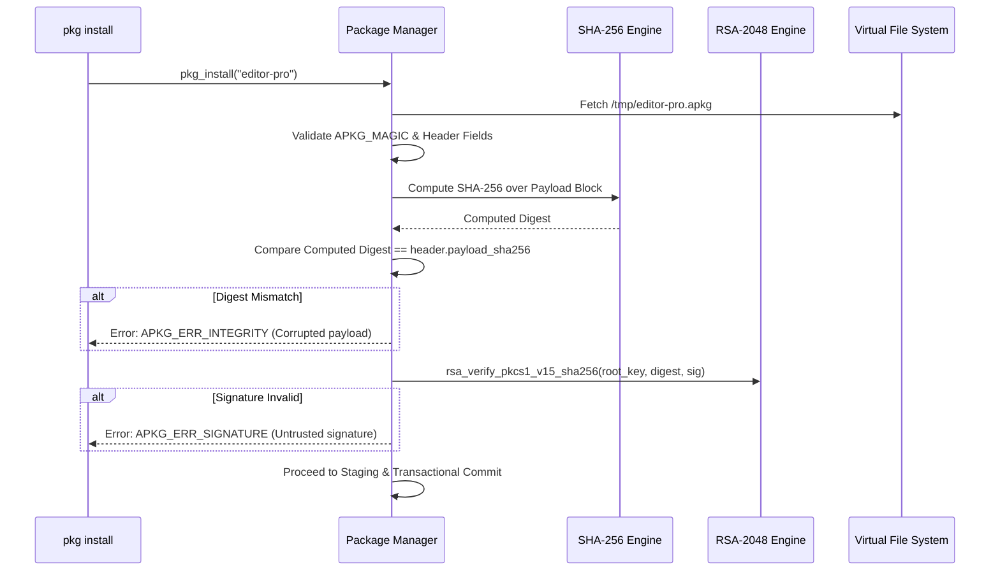
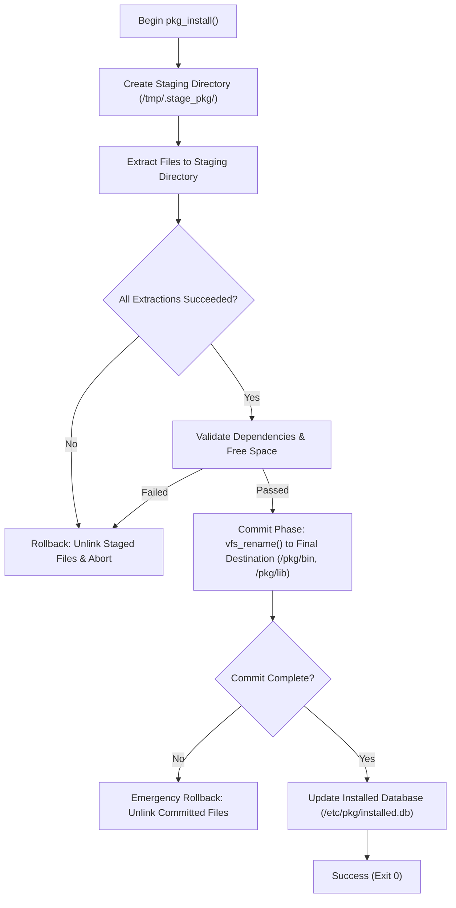

# AstraOS Native Package Manager (`pkg`) — Architecture & Specification

## 1. Executive Summary & Design Tenets

The AstraOS Native Package Manager (`kernel/pkg/pkg.c`) provides an autonomous, cryptographically authenticated, transactional software distribution and lifecycle management system.

Unlike systems relying on external userland package managers written in high-level interpreted languages, AstraOS implements package operations as a robust kernel-assisted native service. This enables secure package verification, installation, atomic rollback, and dependency checking directly on AstraOS without external runtime dependencies.

### Core Architectural Tenets
1. **End-to-End Cryptographic Authentication**: Every `.apkg` archive is cryptographically signed using RSA-2048 PKCS#1 v1.5 over a SHA-256 digest. Unsigned or signature-mismatched packages are rejected prior to any filesystem mutation.
2. **Deterministic Transactional Safety**: Package installations are executed in two distinct phases: staging and atomic commit. If extraction, integrity checks, or dependency resolution fail at any point, all staged files are unlinked and system state is preserved without partial residue.
3. **Dependency Protection**: The package manager strictly verifies dependency hierarchies before installation and enforces reverse dependency locks to prevent accidental deletion of shared libraries or essential tools.
4. **Zero-Overhead Lightweight Database**: Installed package metadata is maintained in a structured binary/record database with fast lookup and minimal storage footprint.

---

## 2. The `.apkg` Binary Package Specification

The AstraOS Package Archive (`.apkg`) format consists of four sequential sections:

```
+-------------------------------------------------------------+
| Header (64 bytes)                                           |
| Magic "APKG\x01\x00\x00\x00", Counts, Sizes, SHA-256 Digest |
+-------------------------------------------------------------+
| Digital Signature Block (256 bytes)                         |
| RSA-2048 PKCS#1 v1.5 Signature over the Payload SHA-256    |
+-------------------------------------------------------------+
| File Entry Table (file_count * 128 bytes)                   |
| Relative Target Path, File Size, Permissions, Offset        |
+-------------------------------------------------------------+
| Package Data Payload (concatenated file bytes)              |
| Raw binary file contents                                    |
+-------------------------------------------------------------+
```

### Data Structures (`<kernel/pkg.h>`)

```c
#define APKG_MAGIC 0x00000001474B5041ULL /* "APKG\x01\x00\x00\x00" */

typedef struct {
    u64  magic;                  /* APKG_MAGIC */
    u32  header_size;            /* Total size of header (64) */
    u32  flags;                  /* Package flags */
    char name[32];               /* Package identifier name */
    char version[16];            /* Semantic version string */
    u32  file_count;             /* Number of files in archive */
    u32  payload_size;           /* Size of payload data in bytes */
    u8   payload_sha256[32];     /* SHA-256 digest of payload */
} __attribute__((packed)) apkg_header_t;

typedef struct {
    u8 signature[256];           /* RSA-2048 PKCS#1 v1.5 signature */
} __attribute__((packed)) apkg_sig_t;

typedef struct {
    char target_path[96];        /* Relative destination path (e.g. "bin/calc") */
    u32  file_size;              /* Byte length of file payload */
    u32  permissions;            /* File mode (e.g. 0755) */
    u32  payload_offset;         /* Offset within payload block */
} __attribute__((packed)) apkg_file_entry_t;
```

---

## 3. Cryptographic Verification Architecture

AstraOS enforces security at the cryptographic level before any package payload is extracted into the system.



### Root of Trust
The AstraOS Root Certificate Authority and RSA-2048 Public Signing Key are embedded within the kernel image (`kernel/include/kernel/test_certs.h`). During kernel bootstrap, the public key is loaded into trusted kernel memory. Signature verification occurs strictly in supervisor mode using high-assurance RSA Montgomery multiplication (`kernel/crypto/rsa.c`).

---

## 4. Transactional Staging & Rollback Engine

To guarantee filesystem consistency, `pkg` performs atomic staging and rollback:



### Rollback Guarantees:
- **Clean Unlinking**: If an extraction is aborted due to insufficient memory or corrupted file blocks, all allocated staging nodes are removed via `vfs_unlink()`.
- **Atomic Promotion**: File moves from staging to final directories utilize `vfs_rename()`, preventing partial binary execution states.
- **Dependency Invariant**: If a required package dependency cannot be satisfied, the entire transaction is cancelled with zero disk modification.

---

## 5. Dependency Management & Cycle Detection

The package metadata records package prerequisites in a directed graph:

1. **Resolution Pipeline**:
   - The package manager queries the dependency list of the requested package.
   - For each dependency, it checks if it is already present in the installed database.
   - If missing, the package manager recursively resolves and stages each required dependency in topological order.
2. **Cycle Prevention**:
   - Visited package identifiers are tracked in an active traversal stack. If a circular reference ($A \to B \to A$) is detected, the transaction terminates with `APKG_ERR_CYCLE`.
3. **Uninstall Protection**:
   - When `pkg remove <package>` is called, the database scans all remaining installed packages.
   - If any installed package declares `<package>` as an active dependency, removal is blocked with an explicit error identifying the dependent packages.

---

## 6. Installed Package Database

Installed package state is tracked in the registry table:

```c
typedef struct {
    char name[32];
    char version[16];
    char files[16][64];
    u32  file_count;
    bool in_use;
} installed_pkg_t;
```

- **Location**: In-memory active table synchronized with `/etc/pkg/installed.db`.
- **Uninstallation**: When a package is removed, every entry in its `files[]` list is unlinked via `vfs_unlink()`, and its entry in `installed.db` is marked free.

---

## 7. Package Repository Infrastructure & Transport

The software repository specification defines the catalog structure and network transport:

- **Repository Index (`packages.idx`)**: Plaintext or binary catalog mapping package names, latest semantic versions, dependencies, file sizes, and descriptions.
- **Transport Security**: Delivered exclusively over TLS 1.3 HTTPS (`kernel/net/tls.c`) or local system media.
- **Command-Not-Found Integration**: The shell engine hooks into `pkg_find_package_for_command()` to automatically recommend packages matching unknown commands.

