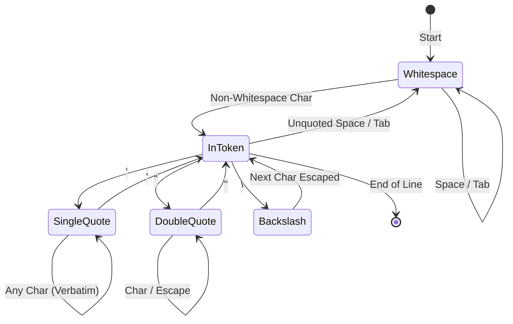
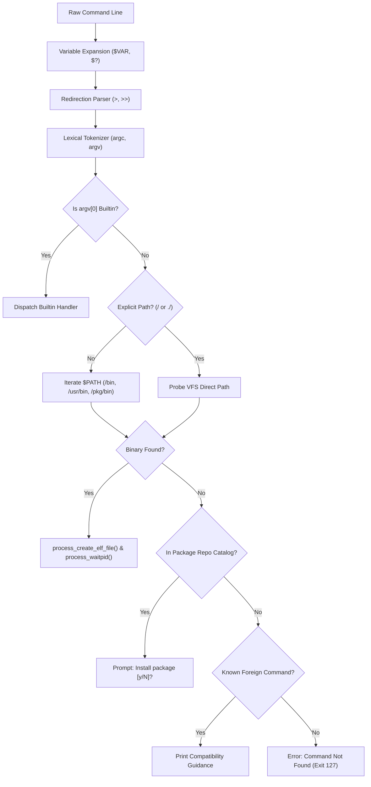

# AstraOS Native Shell Engine — Architecture & Specification

## 1. Executive Summary & Design Philosophy

The AstraOS Native Shell (`kernel/shell/shell.c`) is a high-performance, deterministic command evaluation and execution engine designed natively for AstraOS. Rather than porting monolithic legacy shells such as GNU Bash or Dash, AstraOS implements a modular, embedded-ready shell architecture optimized for microsecond dispatch, zero dynamic memory fragmentation, and full kernel privilege awareness.

### Key Architectural Tenets
1. **Separation of Presentation and Execution**: The shell engine operates on an abstract character I/O stream interface (`shell_out_fn`), completely decouple from the graphical Terminal window (`kernel/gui/app_terminal.c`), serial COM1, or background script contexts.
2. **Deterministic Memory Model**: All environment variable storage, tokenization tables, and path normalization buffers operate in static, predictable layouts without arbitrary unbounded heap allocations.
3. **Native AstraOS Subsystem Integration**: Built-in commands directly interface with kernel services—VFS, PMM, scheduler, networking stack, Local APIC, and the native package manager—avoiding intermediate user/kernel context switch overhead for core operations.
4. **Honest Compatibility Semantics**: The shell does not pretend to be Linux or Windows by mocking missing system behavior. Instead, it provides actionable diagnostic guidance when foreign administrative commands (such as `apt`, `sudo`, or `dir`) are entered, directing users to the equivalent AstraOS native commands.

---

## 2. Shell Context & Data Structures

Every shell instance maintains independent execution state defined in `<kernel/shell.h>`:

```c
#define SHELL_ENV_MAX      32
#define SHELL_KEY_MAX      32
#define SHELL_VAL_MAX      128
#define SHELL_ARGS_MAX     32
#define SHELL_PATH_MAX     128
#define SHELL_LINE_MAX     256

typedef void (*shell_out_fn)(void *ctx, const char *str, u32 color);

typedef struct {
    char key[SHELL_KEY_MAX];
    char val[SHELL_VAL_MAX];
    bool in_use;
} shell_env_entry_t;

typedef struct shell_context {
    char              cwd[SHELL_PATH_MAX];
    shell_env_entry_t env[SHELL_ENV_MAX];
    int               last_exit_code;
    shell_out_fn      out_fn;
    void             *out_ctx;
    
    /* Interactive command-not-found pending installation prompt state */
    bool              pending_install;
    char              pending_pkg[32];
} shell_context_t;
```

### Initial State
Upon shell initialization (`shell_init`):
- `cwd` is set to `/`
- Standard environment variables are populated:
  - `PATH=/bin:/usr/bin:/pkg/bin`
  - `USER=root`
  - `HOME=/`
  - `SHELL=astrashell`
  - `TERM=xterm-256color`
  - `OS=AstraOS`
- `last_exit_code` defaults to `0`

---

## 3. Lexical Analysis & Tokenization

The shell parser (`tokenize_line`) evaluates input character-by-character according to strict POSIX-inspired lexical rules:



### Quoting and Escape Semantics
1. **Single Quotes (`'...'`)**:
   - Every character enclosed within single quotes is treated strictly as literal data.
   - Variable expansion is suppressed.
   - Escape sequences are not processed; backslashes inside single quotes are preserved verbatim.
2. **Double Quotes (`"..."`)**:
   - Preserves whitespace and special delimiter characters (`>`, `;`, `&`).
   - Permits backslash escaping for internal quotes (`\"`), dollar signs (`\$`), and backslashes (`\\`).
   - Supports variable expansion during the pre-tokenization phase.
3. **Backslash Escaping (`\`)**:
   - Escapes the immediate subsequent character outside single quotes, allowing literal inclusion of spaces (`mkdir my\ folder`) and quotation marks.

---

## 4. Variable Expansion System

Variable expansion occurs in `expand_variables()` prior to argument tokenization:

1. **`$VAR` and `${VAR}` Syntax**:
   - The parser identifies leading `$` symbols not preceded by an escape backslash.
   - Variable identifiers accept alphanumeric characters and underscores (`[a-zA-Z0-9_]`).
   - Curly braces `${NAME}` delimit unambiguous boundary names in concatenated strings.
2. **Special Variable `$?`**:
   - Resolves directly to the ASCII decimal string representation of `ctx->last_exit_code`.
   - Allows scripting and conditional execution inspection (e.g., `echo "Exit code: $?"`).
3. **Undefined Variables**:
   - Variables not present in `ctx->env` resolve to an empty string (`""`) without aborting line processing.

---

## 5. Working Directory & Path Canonicalization

The shell manages path navigation deterministically via `sh_normalize_path()`:

1. **Absolute vs. Relative Resolution**:
   - Paths beginning with `/` are evaluated directly from the VFS root.
   - Relative paths are prepended with `ctx->cwd`.
2. **Dot and Double-Dot Traversal**:
   - Path components matching `.` (current directory) are discarded.
   - Path components matching `..` (parent directory) pop the previous path segment, stopping at `/` (root boundary clamp).
3. **Trailing Slashes and Redundant Delimiters**:
   - Consecutive slashes (`//`, `///`) are collapsed into single `/`.
   - Trailing slashes are stripped (except for the root directory `/`).

---

## 6. Command Execution & PATH Search Pipeline

When a command line is executed via `shell_execute()`, the engine applies the following resolution precedence:



### Precedence Hierarchy:
1. **Interactive Pending State**: If the user previously triggered a Command-Not-Found suggestion, the next keystroke evaluates confirmation (`y`/`Y` vs `n`/`N`).
2. **Built-in Commands**: Directly executed in kernel context without process allocation overhead.
3. **Explicit Paths**: Paths containing slashes (`/bin/myprog`, `./test.elf`) are resolved against VFS.
4. **PATH Directories**: The shell searches colon-separated directories specified by `$PATH`. For each candidate `dir`, it tests `dir/cmd` followed by `dir/cmd.elf`.
5. **ELF64 Execution**: If an executable is found, `process_create_elf_file()` creates a Ring 3 task and `process_waitpid()` waits for termination, capturing the exit code into `$?`.
6. **Package Repository Suggestion**: If the command is not installed, the repository catalog is queried.

---

## 7. Input/Output Redirection Architecture

The shell supports standard output redirection via `>` (truncate and write) and `>>` (append):

1. **Parser Hook**:
   - During variable expansion, the shell scans for unquoted `>` and `>>` tokens.
   - The target destination path is extracted and normalized against `ctx->cwd`.
   - The redirection tokens and destination name are sliced out from the command string before argument tokenization.
2. **Descriptor Redirection**:
   - An internal redirection context (`redir_ctx_t`) opens the destination file via `vfs_open(path, flags)` with `VFS_O_CREAT | VFS_O_WRONLY | (append ? VFS_O_APPEND : VFS_O_TRUNC)`.
   - `ctx->out_fn` is temporarily replaced with `redir_writer`, redirecting all output emitted by built-in commands or child streams directly to `vfs_write()`.
3. **Atomic Restoration**:
   - Upon command completion or failure, `ctx->out_fn` and `ctx->out_ctx` are restored to their original targets, and the file descriptor is flushed and closed via `vfs_close()`.

---

## 8. Verification & Qualification

The Shell subsystem is verified via `shell_self_test()` during boot qualification:
- **Environment Manipulation**: Validates `setenv`, `getenv`, variable overwrite, and `unsetenv`.
- **Lexical Tokenization**: Validates single quote literal preservation, double quote escape handling, and whitespace splitting.
- **Variable Expansion**: Validates `$VAR`, `${VAR}`, and `$?` exit code tracking.
- **Command Dispatch**: Executes test runs across built-ins (`echo`, `pwd`, `date`, `uname`, `help`).
- **Emission Marker**: Emits `ASTRA_NATIVE_SHELL_OK` upon complete validation.

